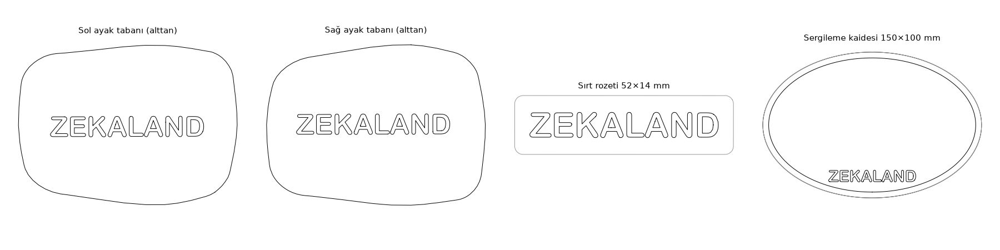

# Zekaland Robot Ördek 🦆

**Yürümeyi yapay zekayla öğrenen, 25 cm boyunda, kendin yapabileceğin çift ayaklı robot ördek. Türkçe yapım rehberi, Türkiye'ye göre alışveriş listesi, ZEKALAND imzalı baskı dosyaları ve yazılımı tek yerde.**

Hazırlayan: **[Zekaland](ZEKALAND.md)** · Alanya · [zekaland.com.tr](https://zekaland.com.tr)



## Bu robot ne yapıyor?

- Ayakta duruyor, yürüyor, düşünce öne takla atıp kendi kalkıyor.
- Yürümeyi bilgisayar simülasyonunda **pekiştirmeli öğrenmeyle** (reinforcement learning) öğreniyor, sonra öğrendiğini gerçek robota aktarıyor.
- Kamerası, mesafe sensörü, hoparlörü ve denge sensörü (IMU) var. Telefondan web paneliyle ya da gamepad ile kumanda ediliyor.
- 15 servo motor, Linux çalıştıran küçük bir ana kart ve 3D baskı gövde. Her şeyi kendin basıp takabiliyorsun.

## Zekaland sürümünde neler var?

| | |
|---|---|
| 🇹🇷 **Tamamen Türkçe rehber** | 21 belge: donanım, montaj, kalibrasyon, yazılım, sorun giderme |
| 🛒 **[Türkiye alışveriş listesi](ALISVERIS_LISTESI.md)** | Ne Türkiye'den, ne AliExpress'ten, ne JLCPCB'den alınır |
| 🖨️ **Hazır Bambu Studio projesi** | 6 tabla, ~411 g PLA, ~22 saat; ayak tabanlarında **ZEKALAND** yazısı |
| 🏷️ **Zekaland aksesuarları** | Sırt rozeti ve sergileme kaidesi |
| 🗺️ **Yol haritası ve kontrol listesi** | Sipariş sırasından ilk ayağa kalkışa adım adım |
| 💻 **Yazılım** | Web kontrol paneli, sistem imajı, servo ve IMU araçları, yürüme öğrenme (simülasyon) ortamı |

## Hızlı başlangıç

1. **[Yol haritası](belgeler/19-yol-haritasi.md)**: Neyi hangi sırayla yapacağın.
2. **[Alışveriş listesi](ALISVERIS_LISTESI.md)**: Önce servoları sipariş et.
3. **[Baskı dosyaları](belgeler/12-baski-ve-cad.md)**: Siparişler yoldayken bas.
4. **[Montaj kılavuzu](belgeler/18-montaj-kilavuzu.md)**: Gövdeden başlayarak 15 alt grup.
5. **[İlk açılış kontrol listesi](belgeler/20-ilk-acilis-kontrol-listesi.md)**: Pili takmadan önce.
6. **[Sorunlar ve çözümleri](belgeler/14-tuzaklar.md)**: Bir şey ters giderse.

## Belgeler

| # | Belge | Konu |
|---|---|---|
| 01 | [Proje notları](belgeler/01-proje-tanitimi.md) | Robotun durumu, videolar, topluluk |
| 02 | [Malzeme listesi (BOM)](belgeler/02-malzeme-listesi-bom.md) | 33 baskı + 23 satın alınan parça |
| 03 | [Donanıma başlangıç](belgeler/03-donanim-baslangic.md) | Kartlar, güç, veri yolu |
| 04 | [Donanım özellikleri](belgeler/04-donanim-ozellikleri.md) | Hızlı başvuru tablosu |
| 05 | [Mekanik satın alma](belgeler/05-mekanik-satin-alma.md) | Rulman, vida, mekanik parçalar |
| 06 | [Elektronik satın alma](belgeler/06-elektronik-satin-alma.md) | Kartlar, kablolar, sensörler |
| 07 | [Vidalar ve bağlantı](belgeler/07-vidalar-ve-baglanti.md) | Vida tipleri ve adetleri |
| 08 | [HAT olmadan kurulum](belgeler/08-hat-olmadan-kurulum.md) | Kart bastırmadan kablolama |
| 09 | [IMU kablo tablosu](belgeler/09-imu-kablo-tablosu.md) | Denge sensörü bağlantıları |
| 10 | [İmaj yazma ve ilk kullanım](belgeler/10-imaj-yazma-ve-ilk-kullanim.md) | SD kart, ilk açılış, kalibrasyon |
| 11 | [Radxa imaj kullanımı](belgeler/11-radxa-imaj-kullanimi.md) | Sistem imajı ayrıntıları |
| 12 | [Baskı ve CAD](belgeler/12-baski-ve-cad.md) | Baskı ayarları, malzeme, dosyalar |
| 13 | [Devre kartları](belgeler/13-devre-kartlari.md) | IMU kartı, dağıtım kartı, pil kartı |
| 14 | [Sorunlar ve çözümleri](belgeler/14-tuzaklar.md) | Satın almadan yazılıma yaşanmış sorunlar |
| 15 | [Hata ayıklama kayıtları](belgeler/15-hata-ayiklama-kayitlari.md) | Gerçek robotta adım adım |
| 16 | [Yapım günlüğü](belgeler/16-yapim-gunlugu.md) | Mekanik yapımın kronolojisi |
| 17 | [Başlangıç rehberi](belgeler/17-baslangic-rehberi.md) | Kısa özet |
| 18 | [Montaj kılavuzu](belgeler/18-montaj-kilavuzu.md) | 15 alt grubun görselli montajı |
| 19 | [Yol haritası](belgeler/19-yol-haritasi.md) | **Zekaland** · Siparişten yürüyüşe |
| 20 | [İlk açılış kontrol listesi](belgeler/20-ilk-acilis-kontrol-listesi.md) | **Zekaland** · Güç, servo, yazılım kontrolleri |

## Repo yapısı

```
belgeler/          Türkçe rehber (21 belge)
modeller/
  feetech/         Bambu Studio projesi + tek tek STL'ler (ZEKALAND tabanlı)
  zekaland/        Rozet, kaide, önizleme
  montaj-gorselleri/
software/          Web kontrol paneli (studio), sistem imajı, güncelleyici, ses, yürüme öğrenme ortamı
tools/             Servo test araçları, Radxa araçları, web servo paneli
scripts/           Yardımcı betikler
araclar/           Zekaland araçları: ZEKALAND imzalı parça üretimi
```

## Yazılım hakkında

`software/` ve `tools/` klasörlerindeki kod olduğu gibi çalışır. Kodun içindeki yorumlar ve bazı alt klasörlerdeki notlar özgün dilinde kaldı. Kullanım anlatımı Türkçe belgelerde var. Web kontrol paneli Python 3.13 ister ([10-imaj-yazma-ve-ilk-kullanim.md](belgeler/10-imaj-yazma-ve-ilk-kullanim.md)).

## Katkı

Kendi ördeğini yaptıysan fotoğrafını, videosunu ya da düzelttiğin bir hatayı paylaş: issue aç ya da **bilgi@zekaland.com.tr** adresine yaz.

## Lisans

- Belgeler ve 3D modeller: **[CC BY-NC-SA 4.0](LICENSE)**. Ticari olmayan kullanım serbest, paylaşırken aynı lisans korunur.
- Yazılım: **[Apache 2.0](LICENSE-APACHE)**.
- Zekaland Robot Ördek, açık kaynak Microduck robotunun ve topluluğun Feetech uyarlamasının üzerine kuruludur. Katkıda bulunanların tam listesi: **[ATIF.md](ATIF.md)**.

---

**[Zekaland](ZEKALAND.md)**: Yapay zeka destekli yeni nesil öğrenme ekosistemi · Alanya
