# Montaj Kılavuzu — Zekaland Robot Ördek (Feetech HD-1910)

Görseller `modeller/montaj-gorselleri/` klasöründedir. Baskı dosyaları: `modeller/feetech/`.

**microduck robot ördek — montaj ve kurulum kılavuzu**

Bileşen sayısı: 15 | SolidWorks montaj çiziminden derlenmiştir.

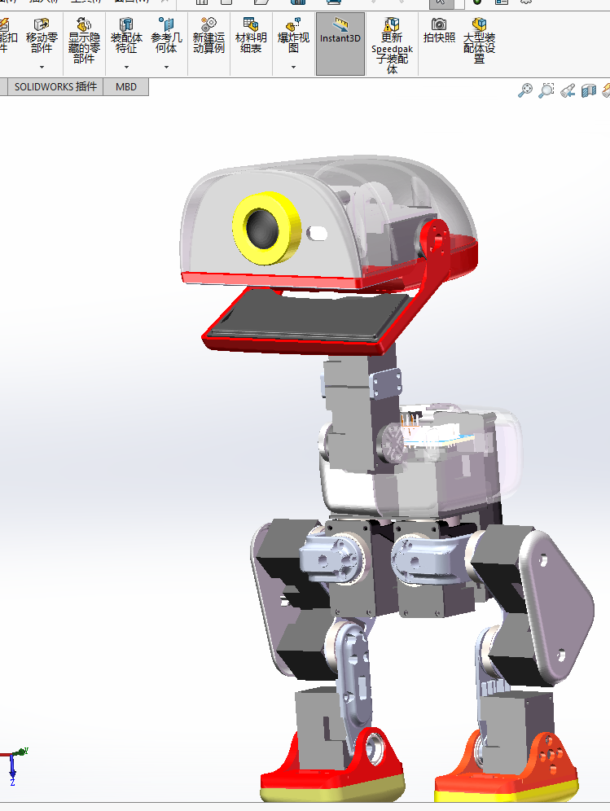

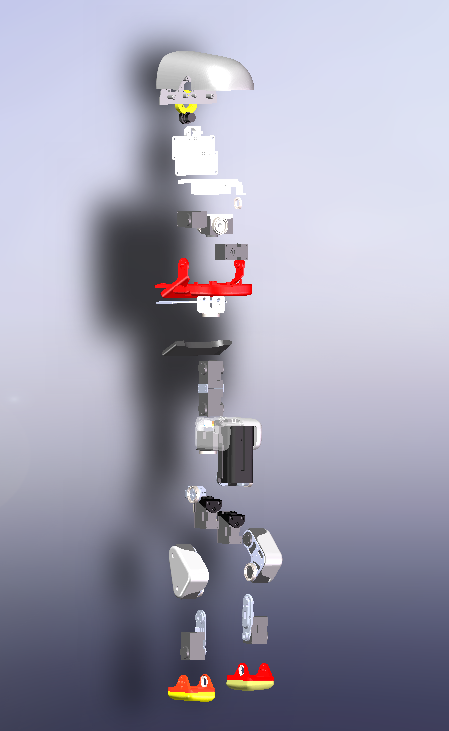

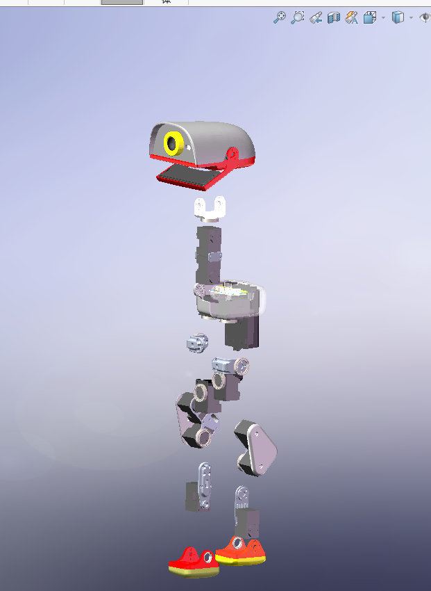

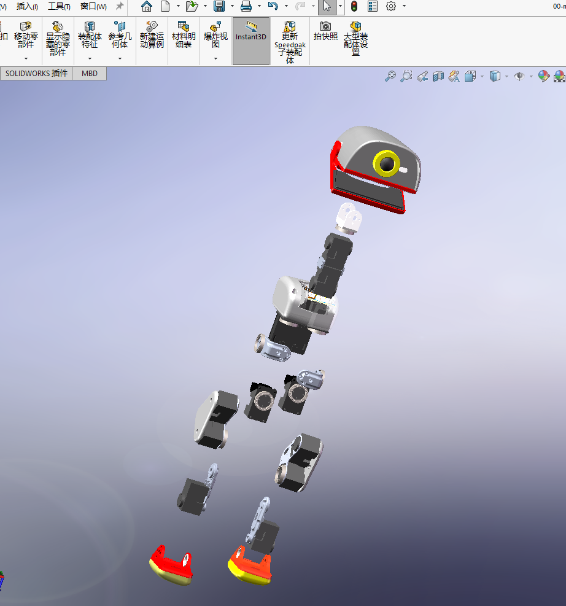

---

## 1. Bileşen listesi

| No | Bileşen adı | İngilizce | Konum / İşlev |
|----|-------------|-----------|---------------|
| 01 | Gövde (ana gövde) | Torso | Robotun ana gövdesi. Tüm bileşenlerin montaj referans parçasıdır; sol/sağ bacakları, boynu ve kontrolcüyü taşır. |
| 02 | Sol kalça | Left Hip | Sol bacağın kökündeki kalça eklemi (Pitch). Bacağın öne-arkaya sallanmasını sağlar. |
| 03 | Sol kalça Roll | Left Hip Roll | Sol bacağın kalçasındaki yana yatma (Roll) eklemi. Bacağın yana sallanmasını sağlar. |
| 04 | Sol üst bacak | Left Thigh | Kalça eklemini alt bacağa bağlayan bacak parçası. |
| 05 | Sol alt bacak | Left Calf | Üst bacağı bilek eklemine bağlayan bacak parçası. |
| 06 | Sol bilek ve ayak | Left Ankle & Foot | Bilek eklemi ve ayak. Ayağın dönmesini ve robotun destek almasını sağlar. |
| 07 | Boyun kökü | Neck Base | Boynun gövdeyle birleştiği yerdeki dönen taban (Yaw). |
| 08 | Boyun pitch | Neck Pitch | Boynun öne-arkaya eğilme (Pitch) eklemi. |
| 09 | Kafa Yaw / Roll | Head Yaw / Roll | Kafanın sağa-sola dönme (Yaw) ve yana yatma (Roll) eklemleri. |
| 10 | Kafa grubu | Head Assembly | Kafanın tamamı: kabuk, sensör/kamera vb. |
| 11 | Sağ kalça | Right Hip | Sağ bacağın kökündeki kalça eklemi (Pitch). Sol kalçanın ayna simetrisidir. |
| 12 | Sağ kalça Roll | Right Hip Roll | Sağ bacağın kalçasındaki yana yatma (Roll) eklemi. Sol kalça Roll'un ayna simetrisidir. |
| 13 | Sağ üst bacak | Right Thigh | Sağ kalçayı sağ alt bacağa bağlayan bacak parçası. Sol üst bacağın ayna simetrisidir. |
| 14 | Sağ alt bacak | Right Calf | Sağ üst bacağı sağ bilek eklemine bağlayan bacak parçası. Sol alt bacağın ayna simetrisidir. |
| 15 | Sağ bilek ve ayak | Right Ankle & Foot | Sağ bilek eklemi ve ayak. Sol bilek ve ayağın ayna simetrisidir. |

---

## 2. Montaj sırası

Bileşenleri numara sırasıyla (01 → 15) monte edin. Önerilen tüm robot montaj sırası şöyledir:

1. **01 Gövde:** Robotun referansı olarak ilk önce sabitlenir.
2. **02–06 Sol bacak:** Sırasıyla sol kalça → sol kalça Roll → sol üst bacak → sol alt bacak → sol bilek ve ayak monte edilir.
3. **07–10 Boyun ve kafa:** Sırasıyla boyun kökü → boyun pitch → kafa Yaw/Roll → kafa grubu monte edilir.
4. **11–15 Sağ bacak:** Sırasıyla sağ kalça → sağ kalça Roll → sağ üst bacak → sağ alt bacak → sağ bilek ve ayak monte edilir.

---

## 3. Bileşen bazında montaj açıklamaları

Aşağıda her bileşen için ad, açıklama, montaj adımları ve dikkat edilecek noktalar verilmiştir. Görseller SolidWorks montaj ekran görüntüleridir.

### 01 Gövde (Torso)

**Açıklama:** Robotun ana gövdesidir. Tüm bileşenlerin montaj referans parçasıdır; sol/sağ bacakları, boynu ve kontrolcüyü taşır.

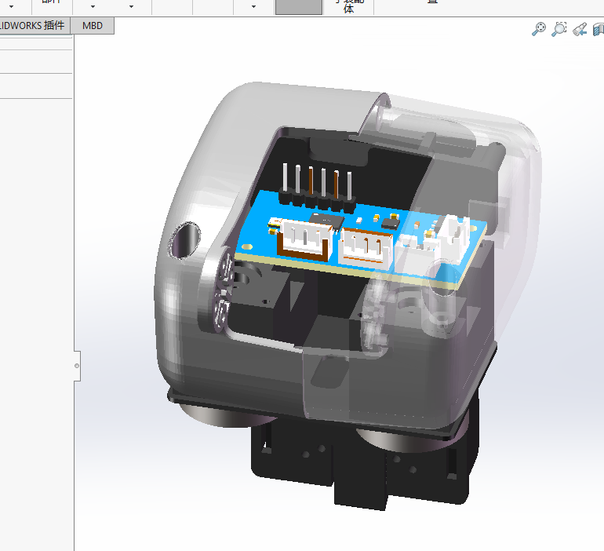

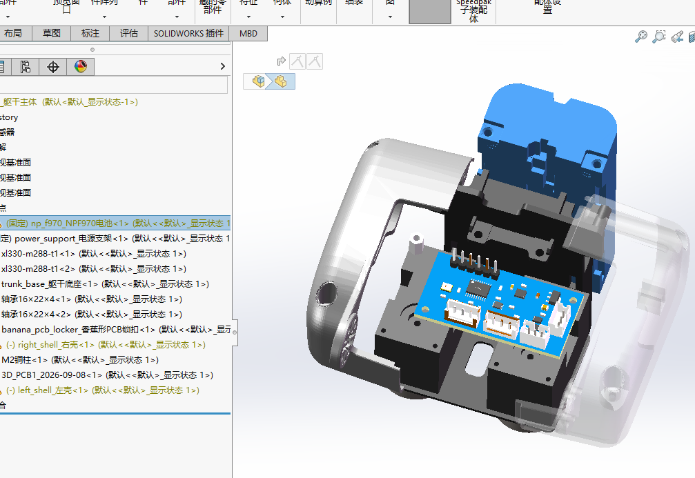

**Montaj adımları:**

1. Gövdeyi tezgâha yatırın. Bağlantı deliklerini, kablo çıkış deliklerini ve servo montaj yerlerini kontrol edin.
2. Gövdede çapak veya yabancı cisim olmadığını, delik dişlerinin sağlam olduğunu doğrulayın.
3. Gövdeyi montaj referansı olarak sabitleyin. Sol bacak, sağ bacak ve boyun sonradan bu parçanın üzerine monte edilecektir.

**Dikkat edilecekler:**

- ⚠ Bu parça referans parçadır. Montaj sırasında güçlü darbelerle şeklini bozmaktan kaçının.
- ⚠ Kabloları her zaman gövdedeki hazır deliklerden çıkarın. Kabloyu ezmek veya sıkıştırmak kesinlikle yasaktır.
- ⚠ Diğer bileşenleri monte etmeden önce delik yönlerini kontrol edin. Aksi halde baştan yapmanız gerekebilir.

---

### 02 Sol kalça (Left Hip)

**Açıklama:** Sol bacağın kökündeki kalça eklemidir (Pitch). Bacağın öne-arkaya sallanmasını sağlar.

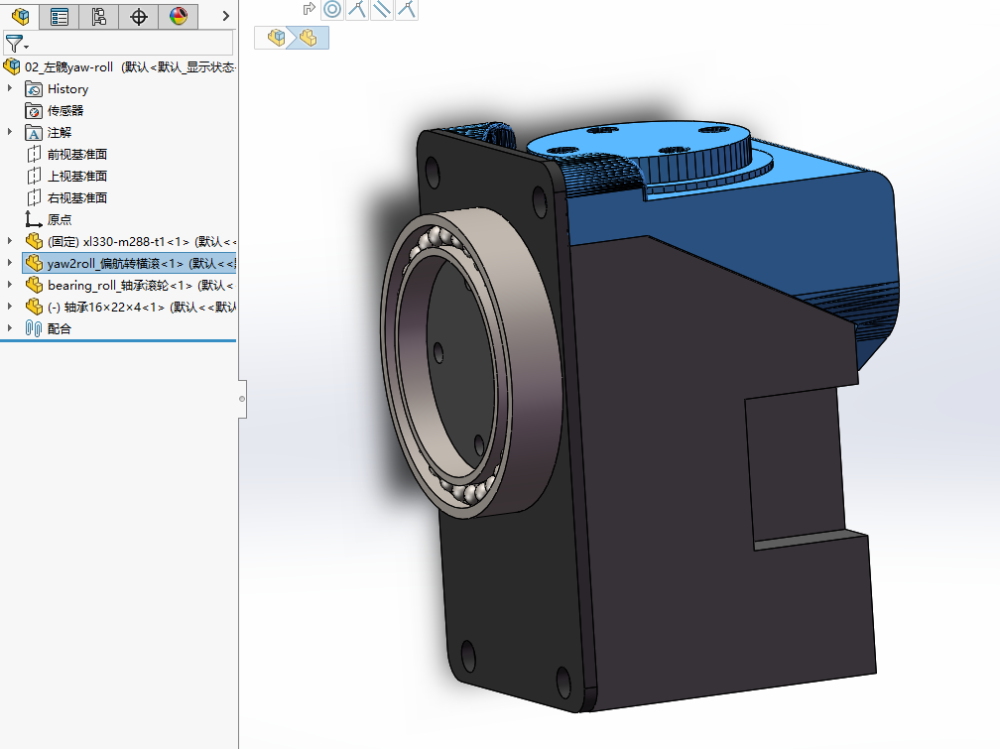

**Montaj adımları:**

1. Sol kalçanın yönünü doğrulayın. Sağ kalçayla ayna simetrisi olan parçalardır, sol-sağ ayrımına dikkat edin.
2. Kalça servosunu montaj yuvasına yerleştirin. Çıkış milinin dönme ekseniyle aynı hizada olduğunu doğrulayın.
3. Vidaları önce çapraz sırayla hafifçe sıkın, sonra eşit biçimde tam sıkın.

**Dikkat edilecekler:**

- ⚠ Servoyu monte etmeden önce enerji verip orta konuma getirin. Aksi halde yanlış montaj nedeniyle hareket aralığı iki yönde eşit olmaz.
- ⚠ Sol ve sağ parçalar ayna simetrisidir. Kesinlikle ters takmayın.
- ⚠ Sıktıktan sonra eklemin akıcı döndüğünü, takılma olmadığını kontrol edin.

---

### 03 Sol kalça Roll (Left Hip Roll)

**Açıklama:** Sol bacağın kalçasındaki yana yatma (Roll) eklemidir. Bacağın yana sallanmasını sağlar.

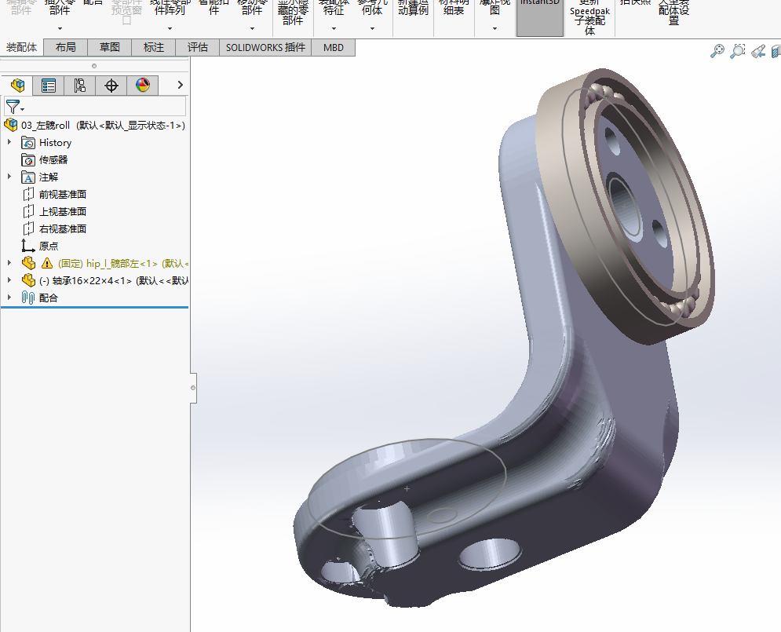

**Montaj adımları:**

1. Kalça eklemiyle aynı eksende veya bitişik olarak monte edin. Roll ekseninin yönünü doğrulayın.
2. Sabitledikten sonra döndürerek yana yatma açı aralığını test edin.

**Dikkat edilecekler:**

- ⚠ Roll'un uç konumlarında gövdeyle çakışma olup olmadığını kontrol edin.
- ⚠ Dönen yerlerde uygun boşluk bırakın. Aksi halde sürtünme, ısınma ve takılma olur.

---

### 04 Sol üst bacak (Left Thigh)

**Açıklama:** Kalça eklemini alt bacağa bağlayan bacak parçasıdır.

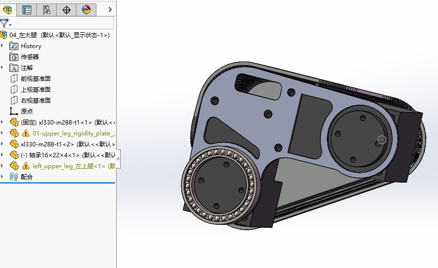

**Montaj adımları:**

1. Üst ucu kalça ekleminin çıkış ucuna, alt ucu alt bacağa bağlayın.
2. Alt ve üst uçtaki mil deliklerinin hizalandığını doğrulayıp sıkın.

**Dikkat edilecekler:**

- ⚠ Üst bacak ile alt bacağın birbirine göre yönüne dikkat edin. Ters monte etmeyin.
- ⚠ Kabloları bacak parçasının dış tarafı boyunca sabitleyin ve eklem hareketi için pay bırakın.

---

### 05 Sol alt bacak (Left Calf)

**Açıklama:** Üst bacağı bilek eklemine bağlayan bacak parçasıdır.

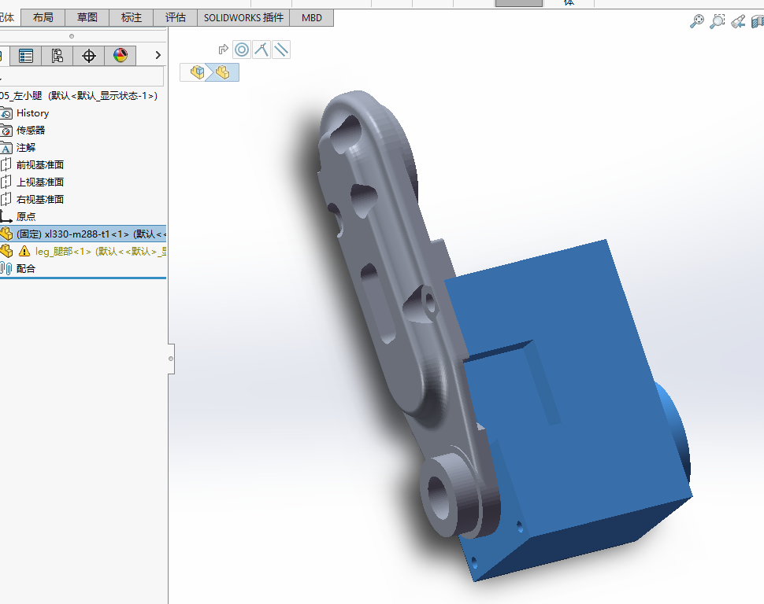

**Montaj adımları:**

1. Üst ucu üst bacağa, alt ucu bilek eklemine bağlayın.
2. Dönüş yönünü ve hareket aralığını doğrulayıp bağlantı vidalarını sıkın.

**Dikkat edilecekler:**

- ⚠ Üst bacakla birleştiği yerde dönüş aralığını kontrol edin. Uç konumlarda sıkışmasın.
- ⚠ Vidaları orta güçte sıkın. Aksi halde plastik parça çatlayabilir.

---

### 06 Sol bilek ve ayak (Left Ankle & Foot)

**Açıklama:** Bilek eklemi ve ayaktır. Ayağın dönmesini ve robotun destek almasını sağlar.

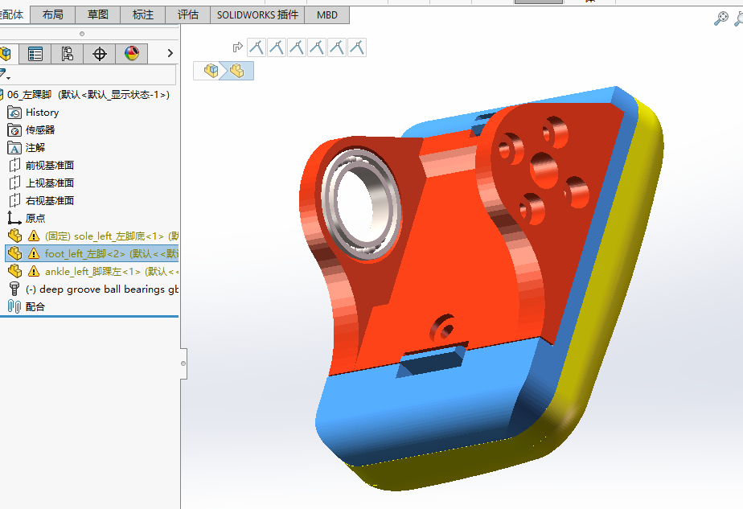

**Montaj adımları:**

1. Üst ucu alt bacağın alt ucuna bağlayın. Ayak, uçtaki destek parçasıdır.
2. Bileğin orta konumunu doğrulayıp sıkın.

**Dikkat edilecekler:**

- ⚠ Ayak tabanının zemine basan yüzeyini kontrol edin. Sol ve sağ ayaklar simetrik olmalı, robot dengeli durmalıdır.
- ⚠ Bileğin orta konumunu kalibre edin. Bu, ayakta dengeyi sağlar.

---

### 07 Boyun kökü (Neck Base)

**Açıklama:** Boynun gövdeyle birleştiği yerdeki dönen tabandır (Yaw).

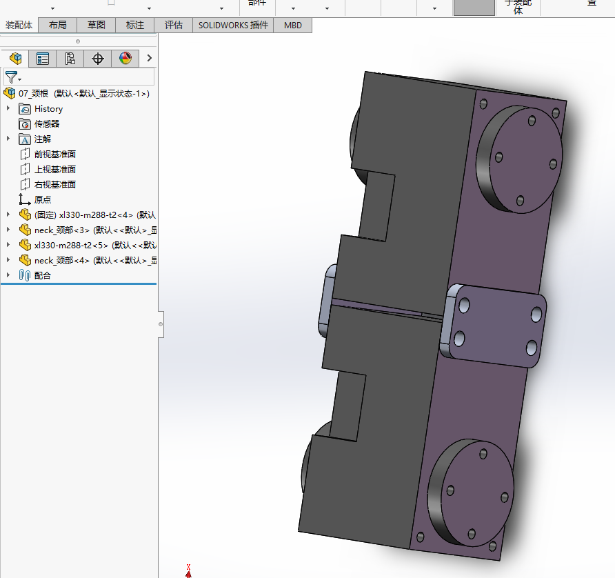

**Montaj adımları:**

1. Gövdenin üstündeki montaj yerine sabitleyin ve dikliğini doğrulayın.
2. Boyun kablolarını hazır delikten çıkarıp sıkın.

**Dikkat edilecekler:**

- ⚠ Gövdeye dik olduğundan emin olun. Aksi halde boyun sonradan eğri kalır.
- ⚠ Kafa yukarı veya aşağı hareket ederken kablolar çekilmesin diye boyun kablolarında yeterli uzunluk bırakın.

---

### 08 Boyun pitch (Neck Pitch)

**Açıklama:** Boynun öne-arkaya eğilme (Pitch) eklemidir.

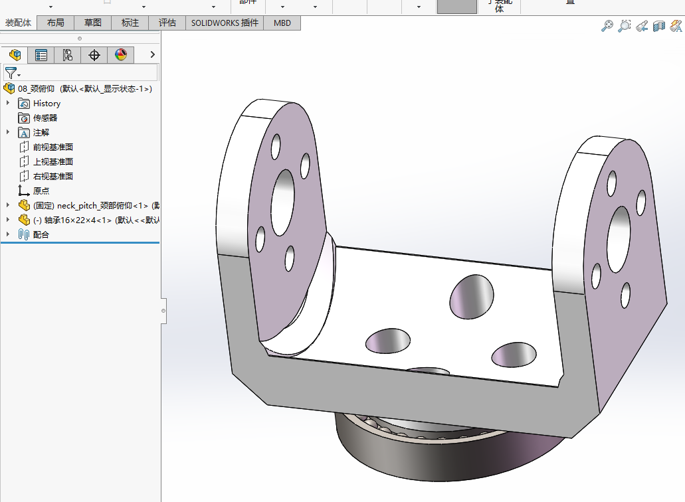

**Montaj adımları:**

1. Üst ucu kafa eklemine, alt ucu boyun köküne bağlayın.
2. Pitch ekseninin yönünü doğrulayıp sıkın.

**Dikkat edilecekler:**

- ⚠ Pitch açı aralığını kontrol edin. Gövde veya kafayla çakışma olmasın.
- ⚠ Pitch orta konumunu kalibre edin. Bu, kafanın başlangıç duruşunun doğru olmasını sağlar.

---

### 09 Kafa Yaw / Roll (Head Yaw / Roll)

**Açıklama:** Kafanın sağa-sola dönme (Yaw) ve yana yatma (Roll) eklemleridir.

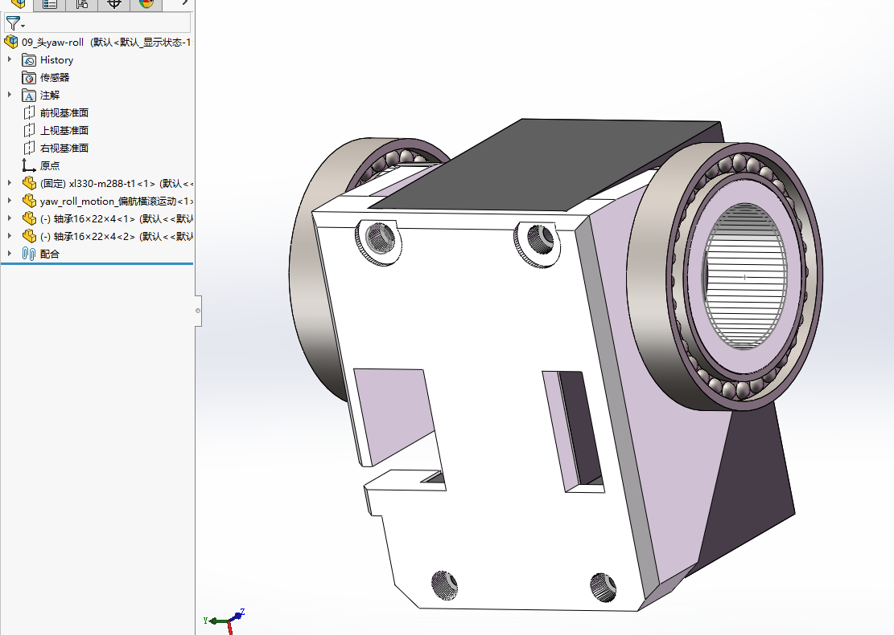

**Montaj adımları:**

1. Boyun pitch eklemini kafa grubuna bağlayın.
2. Yaw ve Roll eksenlerinin yönünün doğru olduğunu doğrulayıp sıkın.

**Dikkat edilecekler:**

- ⚠ Kafanın dönüş aralığını kontrol edin. Kablolar dolanmasın.
- ⚠ Hareketli yerlerde kablolara pay bırakın. Aksi halde bükülme hasarı oluşur.

---

### 10 Kafa grubu (Head Assembly)

**Açıklama:** Kafanın tamamıdır; kabuk, sensör/kamera vb. içerir.

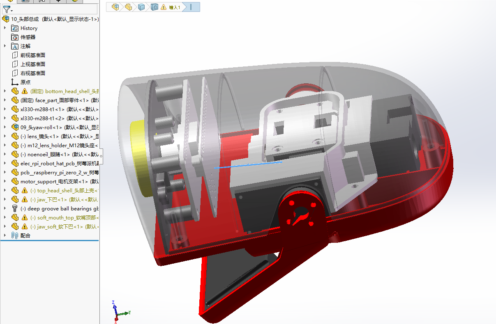

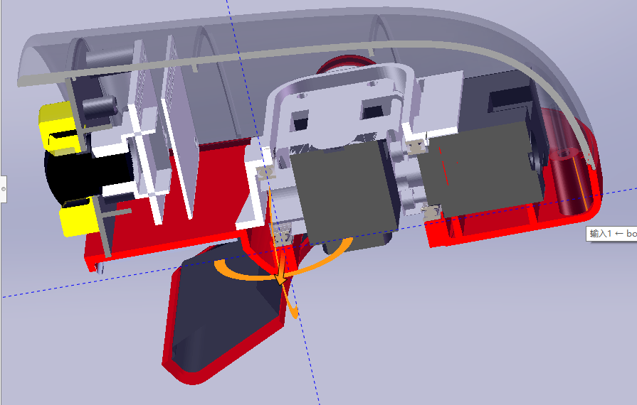

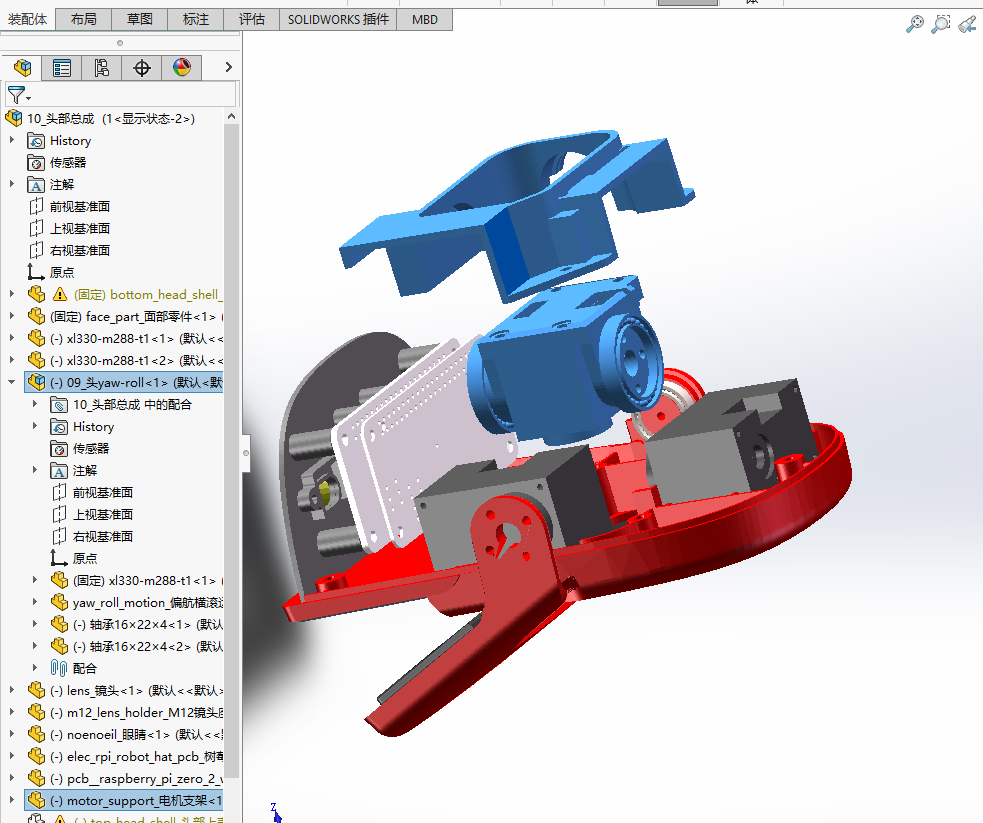

**Montaj adımları:**

1. Patlatılmış görünüme bakarak kafanın iç yapısını sırayla monte edin (ekteki görsele bakın).
2. Kabuğu iç taşıyıcıyla hizalayın; şerit kabloyu ve sensörü takın.
3. Kabuğu kapatın ve sabitleme vidalarını sıkın.

**Dikkat edilecekler:**

- ⚠ Kabuğun klipslerini veya vidalarını hizalarken şerit kabloyu ezmeyin.
- ⚠ Sensör/kamera penceresinin öne baktığından emin olun; yönü kontrol edin.
- ⚠ Kafa dönerken çekilmesin diye şerit kabloda hareket payı bırakın.

---

### 11 Sağ kalça (Right Hip)

**Açıklama:** Sağ bacağın kökündeki kalça eklemidir (Pitch). Sol kalçanın ayna simetrisidir.

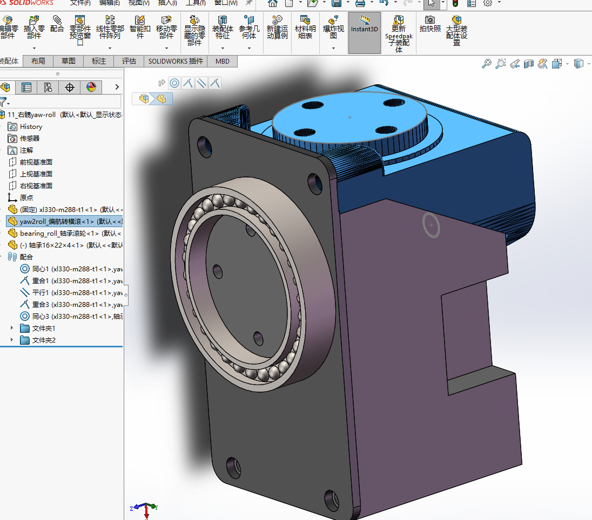

**Montaj adımları:**

1. Sağ kalçanın yönünü doğrulayın. Sol kalçanın ayna simetrisi olan parçadır.
2. Kalça servosunu yerleştirin. Çıkış mili dönme eksenine hizalı olmalıdır.
3. Çapraz sırayla hafifçe sıkın, sonra eşit biçimde tam sıkın.

**Dikkat edilecekler:**

- ⚠ Servoyu önce orta konuma getirin, sonra sıkın.
- ⚠ Sol kalçanın ayna simetrisi olarak monte edin. Kesinlikle ters takmayın.
- ⚠ Sıktıktan sonra dönüşün akıcı olduğunu kontrol edin.

---

### 12 Sağ kalça Roll (Right Hip Roll)

**Açıklama:** Sağ bacağın kalçasındaki yana yatma (Roll) eklemidir. Sol kalça Roll'un ayna simetrisidir.

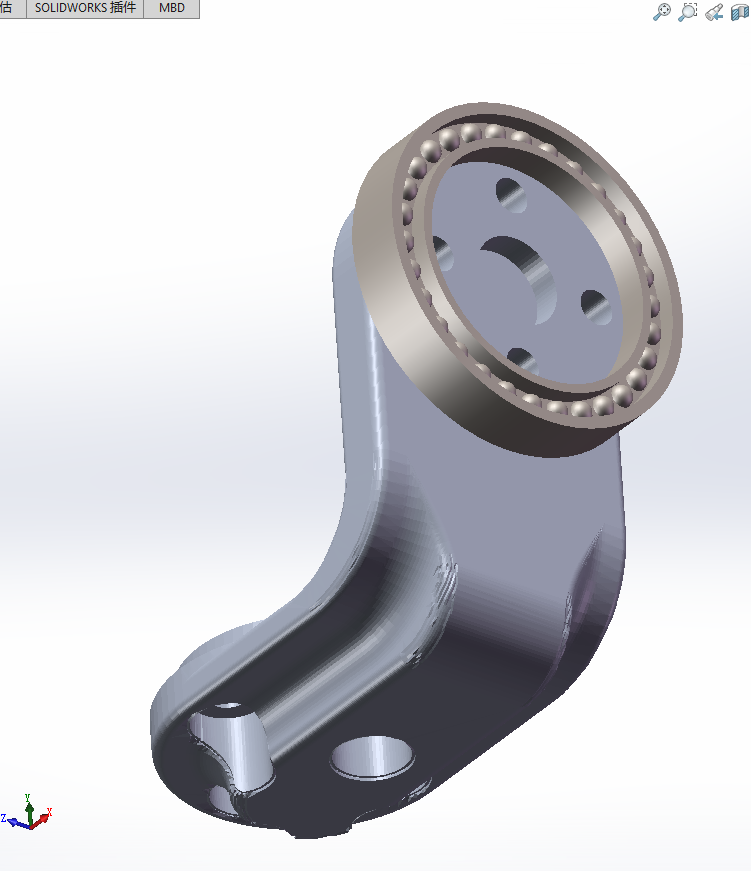

**Montaj adımları:**

1. Sağ kalçayla aynı eksende veya bitişik olarak monte edin. Roll ekseninin yönünü doğrulayın.
2. Sabitledikten sonra döndürerek yana yatma açı aralığını test edin.

**Dikkat edilecekler:**

- ⚠ Roll'un uç konumlarında gövdeyle çakışma olup olmadığını kontrol edin.
- ⚠ Hareketlerin tutarlı olması için sol kalça Roll ile simetriyi koruyun.

---

### 13 Sağ üst bacak (Right Thigh)

**Açıklama:** Sağ kalçayı sağ alt bacağa bağlayan bacak parçasıdır. Sol üst bacağın ayna simetrisidir.

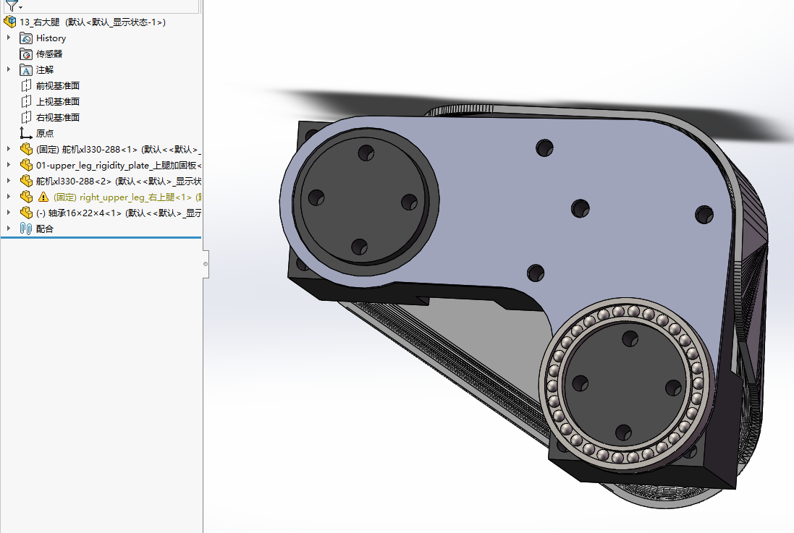

**Montaj adımları:**

1. Üst ucu sağ kalça ekleminin çıkış ucuna, alt ucu sağ alt bacağa bağlayın.
2. Alt ve üst mil deliklerinin hizalandığını doğrulayıp sıkın.

**Dikkat edilecekler:**

- ⚠ Sol üst bacağın ayna simetrisi olduğuna dikkat edin. Ters monte etmeyin.
- ⚠ Kabloları bacak parçasının dış tarafı boyunca sabitleyin.

---

### 14 Sağ alt bacak (Right Calf)

**Açıklama:** Sağ üst bacağı sağ bilek eklemine bağlayan bacak parçasıdır. Sol alt bacağın ayna simetrisidir.

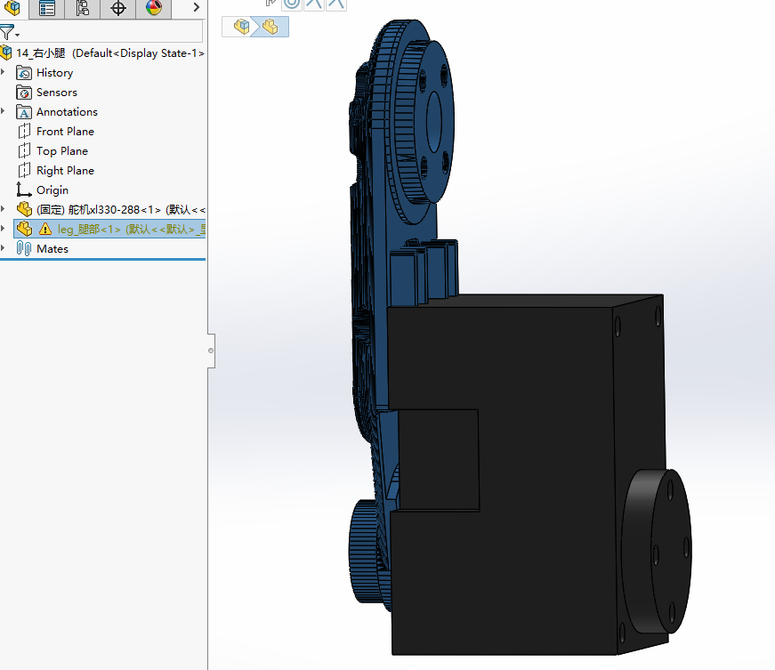

**Montaj adımları:**

1. Üst ucu sağ üst bacağa, alt ucu sağ bilek eklemine bağlayın.
2. Dönüş yönünü doğrulayıp sıkın.

**Dikkat edilecekler:**

- ⚠ Sol alt bacakla ayna simetrisi olmalıdır.
- ⚠ Vidaları orta güçte sıkın.

---

### 15 Sağ bilek ve ayak (Right Ankle & Foot)

**Açıklama:** Sağ bilek eklemi ve ayaktır. Sol bilek ve ayağın ayna simetrisidir.

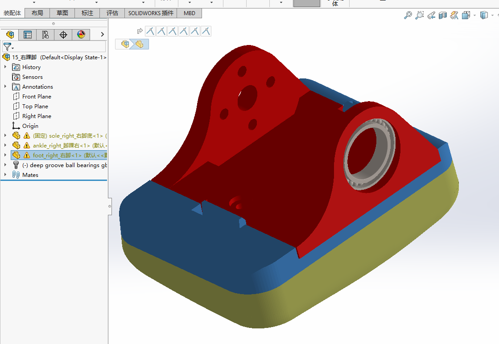

**Montaj adımları:**

1. Üst ucu sağ alt bacağın alt ucuna bağlayın. Ayak, uçtaki destek parçasıdır.
2. Bileğin orta konumunu doğrulayıp sıkın.

**Dikkat edilecekler:**

- ⚠ Sol bilek ve ayakla simetrik olmalı; iki ayak da zemine dengeli basmalıdır.
- ⚠ Bileğin orta konumunu kalibre edin. Bu, ayakta dengeyi sağlar.

---

## 4. Genel dikkat edilecekler

- Montajdan önce BOM listesine bakarak parça sayısını ve ölçülerini sayın. M2 ve M2.5 vida/bağlantı elemanlarının tam olduğunu doğrulayın.
- Servolu eklem parçalarında: sıkmadan önce enerji verip orta konuma getirin. Aksi halde hareket aralığı kayar.
- Vidaları çapraz sırayla, adım adım hafifçe sıkın. Tek taraflı yük parçanın şeklini bozar. Plastik parçaları asla fazla sıkmayın.
- Sol-sağ simetrik parçaları (kalça / üst bacak / alt bacak / bilek ve ayak) mutlaka ayırt edin. Kesinlikle ters takmayın.
- Kabloları toplu halde sabitleyin ve eklem hareketi için pay bırakın. Kabloyu ezmek, sıkıştırmak veya dolamak kesinlikle yasaktır.
- Her hareketli eklemi bitirdiğinizde bir kez döndürerek test edin; çakışma, takılma ve anormal ses olup olmadığına bakın.
- Gevşemeyi önlemesi gereken bağlantılarda uygun miktarda vida sabitleyici (Loctite 243) kullanmanız önerilir (BOM'a göre).
- İlk enerji vermeden önce tüm elektrik bağlantılarını, yalıtımı ve kutupları kontrol edin; her şeyin doğru olduğundan emin olduktan sonra enerji verin.

---

## 5. Önerilen aletler

- Yıldız / alyan tornavida (ölçüler BOM listesine göre);
- Cımbız (küçük vidalar, şerit kablo ve klipsler için);
- Vida sabitleyici (Loctite 243) (gevşemesi istenmeyen bağlantılar için);
- Servo orta konum ayar aracı / kontrol kartı (eklemleri orta konuma getirip kalibre etmek için).

---

## Zekaland notu

Ayak tabanlarının altında ZEKALAND yazısı kazılıdır; robot kaldırıldığında ya da sergilendiğinde görünür. Tabanları TPU ile basmanızı öneririz. TPU hem sürtünmeyi artırır hem de adım sertliğini yumuşatır. İsteğe bağlı sırt rozetini (`modeller/zekaland/zekaland_rozet.stl`) basıp gövdenin arkasına yapıştırabilirsiniz.

---
*Zekaland Robot Ördek belgeleri · Lisans ve katkıda bulunanlar: [ATIF.md](../ATIF.md)*
